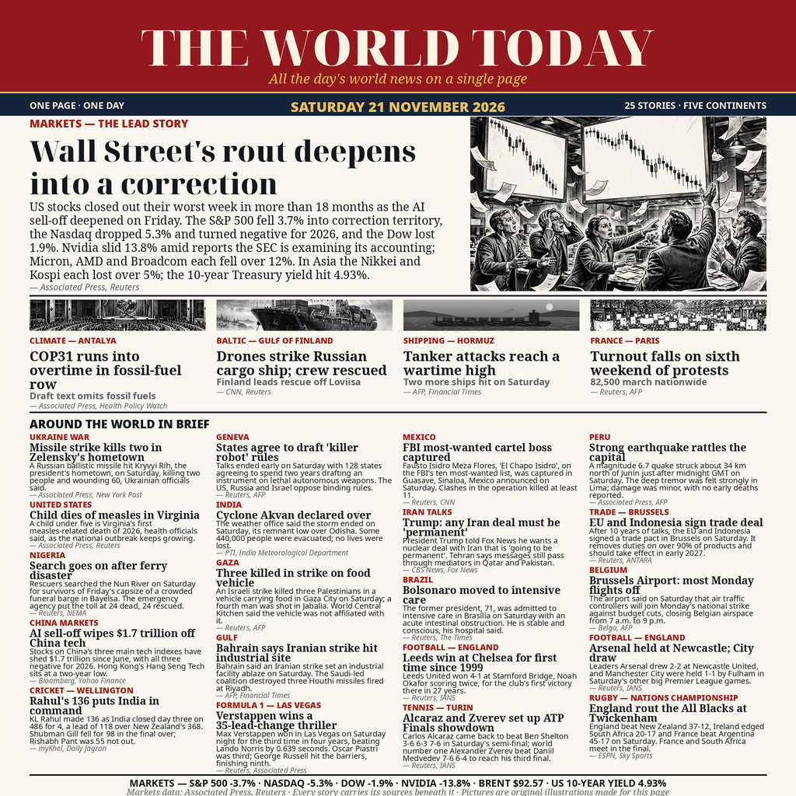

# THE WORLD TODAY — Saturday 21 November 2026

Entry for the make.fun bounty **news-image-20261121** ("Sum up 21 November's
world news in one image") — bounty page: https://make.fun/bounty/news-image-20261121.

One front page, 25 stories: Wall Street's rout deepening into a correction —
the S&P 500 down 3.7%, the Nasdaq 5.3% and Nvidia 13.8% in the worst week
for US stocks in more than 18 months — as the lead; the COP31 climate talks
in Antalya running into a second day of overtime over a draft that omits
fossil fuels; two drones striking the Russian cargo ship Sparta II in the
Gulf of Finland; tanker attacks around the Strait of Hormuz reaching a
wartime high; and falling turnout on the sixth weekend of French protests —
plus twenty world briefs, among them a missile strike on Kryvyi Rih, the
Geneva agreement to draft 'killer robot' rules, the capture of FBI
most-wanted cartel boss 'El Chapo Isidro', the EU–Indonesia trade deal
signed in Brussels, Bolsonaro moved to intensive care, Verstappen's Las
Vegas thriller, and England routing the All Blacks at Twickenham — plus the
day's market moves in the footer.

## How it was made

- Every story happened, or was first reported, on Saturday 21 November 2026
  and is confirmed by at least two independent credible outlets (Reuters,
  AP, AFP, CNN and peers). The full sourcing, with the exact facts and
  figures behind every line, is in [SOURCES.md](SOURCES.md). Items that
  could not be double-sourced, or that turned out to belong to an earlier
  day, were dropped.
- The page was composed at 2048×2048 with PIL and downscaled with Lanczos
  to 1024×1024, saved as JPEG quality 93 with 4:4:4 chroma (subsampling 0).
  The render is deterministic: two runs produce byte-identical files.
- The source printed directly beneath each story is the sourcing for that
  story.
- All five pictures are original illustrations made for this page — four
  generated, one drawn programmatically — and carry no text.

## Running it

`main.py` (Python 3, standard library only) verifies `entry.png` against
its pinned length and SHA-256 digest and copies it to
`$MAKEFUN_OUTPUT_DIR/entry.png` (or `/output/entry.png`).

## License

MIT — see [LICENSE](LICENSE).
